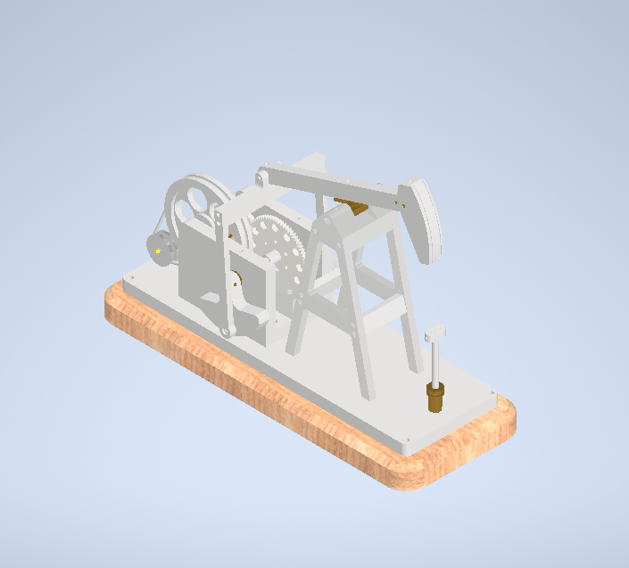

# Oil Rig CAD Model

An Autodesk Inventor modelling exercise showing a pumpjack assembly on a base.

## Naming note

The portfolio calls this project "Oil Rig Design." Its two renders show a pumpjack, rather than a complete drilling rig. This repository uses the more precise name while preserving the original project description.

## Project summary

The portfolio dates the work to December 2025 and describes it as the designer's first hands-on CAD project. Individual parts and structural elements were modelled and arranged while learning the Autodesk Inventor environment. The images visibly include a base, support frame, walking beam, horsehead, wheel and crank region, and linkage.

A pumpjack normally converts rotary drive into reciprocating rod movement. These renders document a CAD exercise; they do not establish a working field machine, load rating, or operating cycle.

## Images

- [Overview](images/pumpjack-overview.png)
- [Drive-side view](images/pumpjack-drive-side.png)

## Design process and outcome

The main challenge described in the portfolio was translating a mechanical concept into a 3D model while learning new software. The designer explored modelling tools, followed tutorials, and practised applying them to parts. The reported outcome was increased confidence with Inventor and a foundation for later assembly projects.

## Reconstructing the model

Define the fixed base and frame, then set the beam pivot, drive axis, crank offset, and linkage lengths. Model the moving group around those reference points. Assemble with revolute joints, drive one crank revolution, and inspect the motion envelope. [BUILD_GUIDE.md](BUILD_GUIDE.md) gives the steps in more detail.

## Evidence and next steps

This repository contains two portfolio renders and the narrative. No matching native Inventor part or assembly files were verified. Exact dimensions, materials, gear ratio, motion study, drawings, and load calculations are unknown. A separate pumpjack tutorial PDF was found locally, but its relationship to this project was not established, so it is not reproduced here.

Add the verified Inventor assembly and referenced parts, a dimensioned drawing, a bill of materials, motion output, and attribution for any third-party reference that was actually used.
